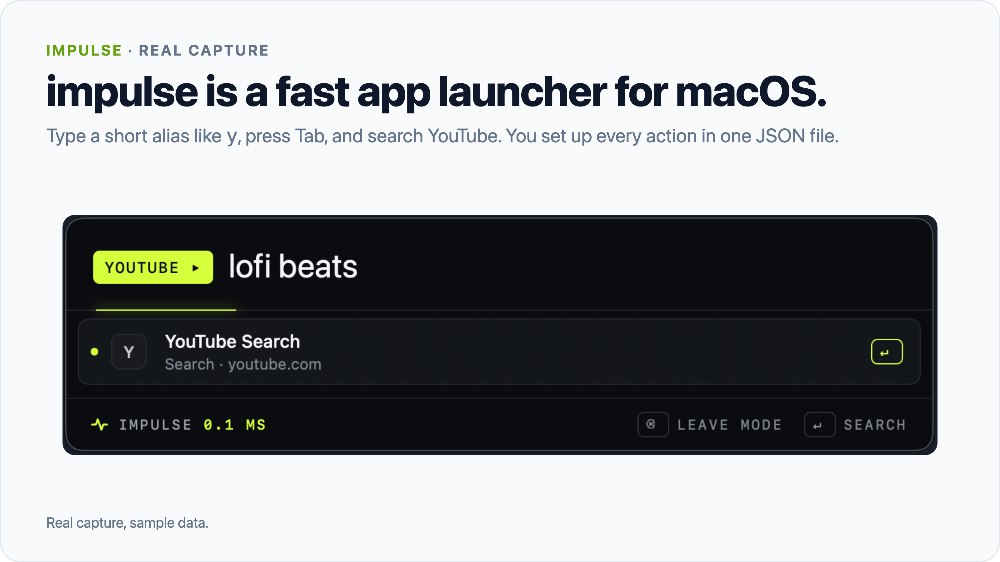
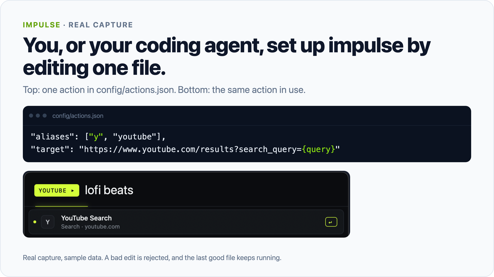
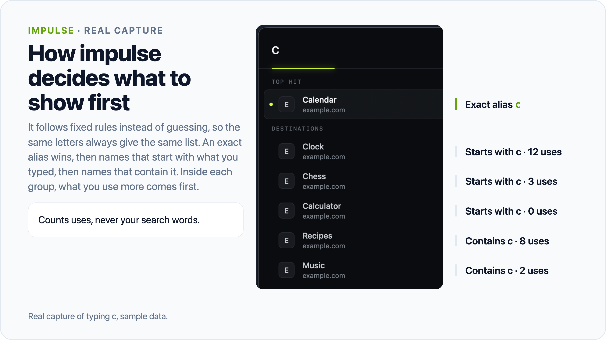
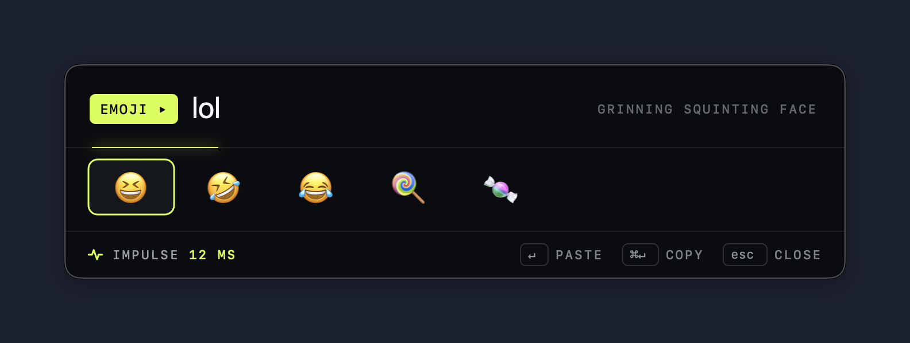

# Impulse

Impulse is a fast app launcher for macOS. You, or your coding agent, set up every action in one JSON file.



```sh
git clone https://github.com/AaqifZ/impulse.git
cd impulse
zsh scripts/setup.sh && open dist/Impulse.app
```

Then press **Command-Space**.

## Why

Impulse keeps every alias, search, snippet, and script in one plain file: `config/actions.json`. You can read it in one screen, back it up, and let an agent edit it. A bad edit cannot break the running launcher:

- Impulse checks each edit before it takes effect. A bad edit leaves the last good version running.
- The same input gives the same result. There is no AI, no model call, no account, and no telemetry.
- `launcherctl` validates, applies, tests, and rolls back changes from the terminal, with JSON output an agent can parse.





## Install

You need macOS 13 or later and Apple's Swift command-line tools (Swift 5.9 or later). Install the tools with `xcode-select --install`. Tested on macOS 26 with Swift 6.3.

1. Run the three commands above. Setup copies `examples/actions.json` to `config/actions.json` if that file is missing, then builds the app into `dist/`. It never replaces your configuration.
2. Free Command-Space first if Spotlight or another launcher uses it. Impulse does not change other apps' shortcuts.
3. Keep the whole folder together. The app finds `config/` next to `dist/`, so do not move `Impulse.app` on its own.

To rebuild after a change, run `zsh scripts/build.sh`.

## Use

| Type | Result |
|---|---|
| `y`, then Tab, then words, then Return | YouTube search |
| `g`, then Tab, then words, then Return | Google search |
| `y cats` | Inline search, no Tab needed |
| `maps` or `gcal` | Google Maps search, Google Calendar |
| An app name | Open the app |
| `example.com` | Open the web address |
| Any other phrase | Choose Google, Google Drive, or a search of your files |
| `files <name>` | Search indexed files and folders in your home folder |
| `2 * (3 + 4)` or `10 km in miles` | Local answer. Return copies it |
| `100 USD in AUD` | Currency conversion with the rate date |
| `clipboard` or `clip <term>` | Clipboard history, off until you turn it on |
| `shortcuts` | Your Apple Shortcuts. Each run asks to confirm |
| `system` | Home, Downloads, Desktop, Applications, System Settings |
| `theme` | Signal (default), Glass, or Compact. Arrows preview, Return saves |
| `stats` | Your last 28 days of use, plus alias suggestions |
| **Control-Space** or `emoji` | Emoji picker |

Escape closes the panel. Command-Y previews a file. Command-Return shows a file or app in Finder.

### Stats and alias suggestions

Impulse logs one line for each panel open and each finished action: the time, the action ID, its kind, the number of keys you typed, and the time it took. It never logs search words, snippet text, clipboard contents, or file paths. An emoji pick logs the emoji, so the picker can rank it. The log stays in `config/runtime/usage/`. Type `stats reset` to delete it.

When you type an action the long way at least 5 times in 28 days, `stats` can suggest a short alias. Press Return to add it to `config/actions.json`. Time saved is an estimate from fixed typing speeds.

### Emoji picker



*Real capture, sample data.*

Press Control-Space, type a word such as `fire`, move with the arrow keys, and press Return. Command-Return copies the emoji only. The 1,914 emoji ship inside the app, so the picker never uses the network.

If macOS uses Control-Space to switch input sources, turn that shortcut off in System Settings > Keyboard > Keyboard Shortcuts > Input Sources.

Return pastes only when [Hammerspoon](https://www.hammerspoon.org) runs `automation/impulse-paste.lua` (see [automation/README.md](automation/README.md)). Without it, the emoji stays on your clipboard.

If you move from Raycast, `python3 scripts/import_raycast_emoji.py` reads Raycast's local emoji history and writes your most used emoji to `config/emoji-seed.json`. Your own picks then rank above them.

### Configure

Each action is one JSON object:

```json
{"id": "youtube", "name": "YouTube Search", "aliases": ["y", "youtube"], "kind": "url",
 "target": "https://www.youtube.com/results?search_query={query}",
 "emptyQueryTarget": "https://www.youtube.com/"}
```

| Kind | Target |
|---|---|
| `url` | A web address. Put `{query}` where the search words go. Add `"browser": "<bundle ID>"` to pick a browser |
| `app` | An app's bundle ID |
| `snippet` | Text to copy. `{date format="yyyy-MM-dd"}` inserts today's date |
| `terminal` | The absolute path to an executable `.command` file. It runs without a second confirmation, so review it first |
| `workspace` | A URL that another app handles, such as `hammerspoon://grid`. Impulse starts that app if needed, then opens the URL |

Typed web addresses open in the browser of your `g` action, or in your default browser.

The app reads `config/actions.json` next to `dist/`, or the file named in the `IMPULSE_CONFIG` environment variable. Impulse watches the file. A valid edit takes effect at once. An invalid edit is ignored, and the last valid version keeps running.

Website icons are optional local PNG files in `config/icons/`. Impulse never downloads icons.

### From the terminal

`launcherctl` reads `config/actions.json` in the current folder, or the file you pass with `--config`. Output is JSON.

```sh
dist/launcherctl validate candidate.json   # check a new version, change nothing
dist/launcherctl apply candidate.json      # check it, then make it live
dist/launcherctl rollback                  # go back one version
dist/launcherctl resolve 'y cats & dogs'   # show what an input would open
dist/launcherctl status                    # is the app running, and which revision
dist/launcherctl suggest                   # alias suggestions
dist/launcherctl alias youtube yt          # add an alias
```

### Optional: Larynx dictation history

Larynx is a local dictation app. If `~/.larynx/history.db` exists, `lx` lists your recent dictations and `larynx` shows a 28-day summary. Impulse opens the file read-only; without it, both words are ordinary searches.

## How it works

Impulse has three parts:

- `LauncherCore` is plain Swift with no UI. It loads and validates the configuration, routes each query, ranks matches, and does the math.
- `LauncherApp` is the AppKit panel. It owns the global shortcut, app discovery, file search, clipboard history, and themes.
- `launcherctl` is a command-line tool on top of `LauncherCore`.

The router returns either an action to run or a typed answer, such as a calculation. The same input and the same configuration always give the same result. Recent use can reorder matches of equal strength, but it never adds or removes a match.

Run the tests:

```sh
zsh scripts/test.sh
```

The script builds the app, runs four test runners, checks the CLI's JSON output, and runs the app's self-tests. Self-tests use temporary folders and private pasteboards, not your configuration or clipboard.

Built with AI coding agents. Not affiliated with Raycast or Apple.

## Limits

- Not a full Spotlight or Raycast replacement. There is no snippet expansion, window management, extension store, browser-tab search, launch at login, or automatic update.
- Builds are ad-hoc signed on your Mac, not notarized.
- File search uses Spotlight inside your home folder. It starts after 3 characters and shows up to 20 results. Spotlight indexing decides what it finds.
- Currency rates come from [Frankfurter](https://frankfurter.dev/). Impulse sends the currency codes, never the amount, and caches rates for 12 hours. It is not a trading feed.
- Clipboard history is off at each start. When on, it keeps text only, in memory: 50 entries, 24 hours, 16 KB each. It skips known password managers and concealed types, but macOS cannot always say which app wrote to the clipboard.
- Apple Shortcuts get a stop request after 2 minutes. Effects that already happened stay.

## License

[MIT](LICENSE). The vendored [HotKey](https://github.com/soffes/HotKey) library and the emoji data ([emojilib](https://github.com/muan/emojilib), [unicode-emoji-json](https://github.com/muan/unicode-emoji-json)) are MIT licensed. See [THIRD_PARTY_NOTICES.md](THIRD_PARTY_NOTICES.md) and `vendor/`.
